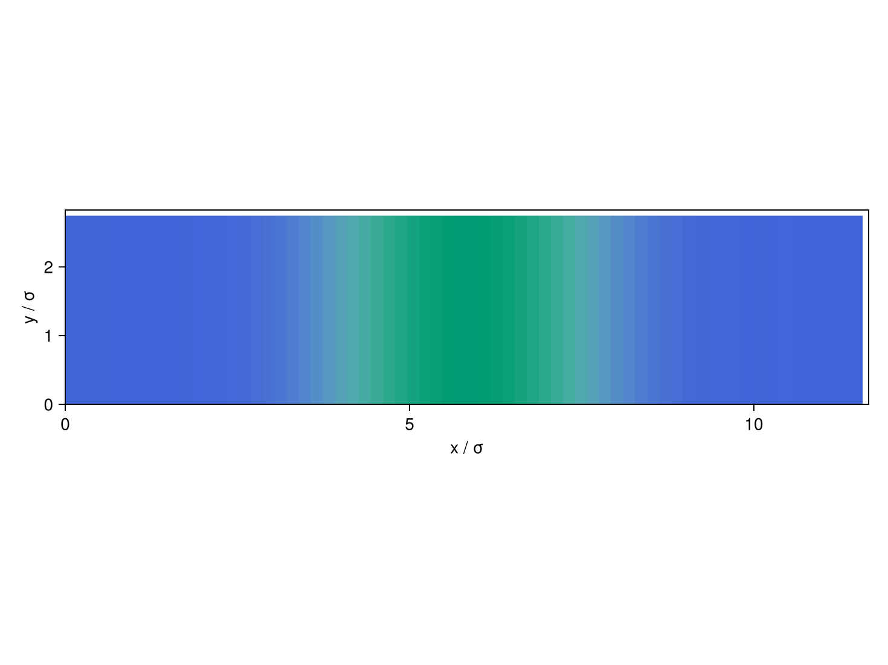
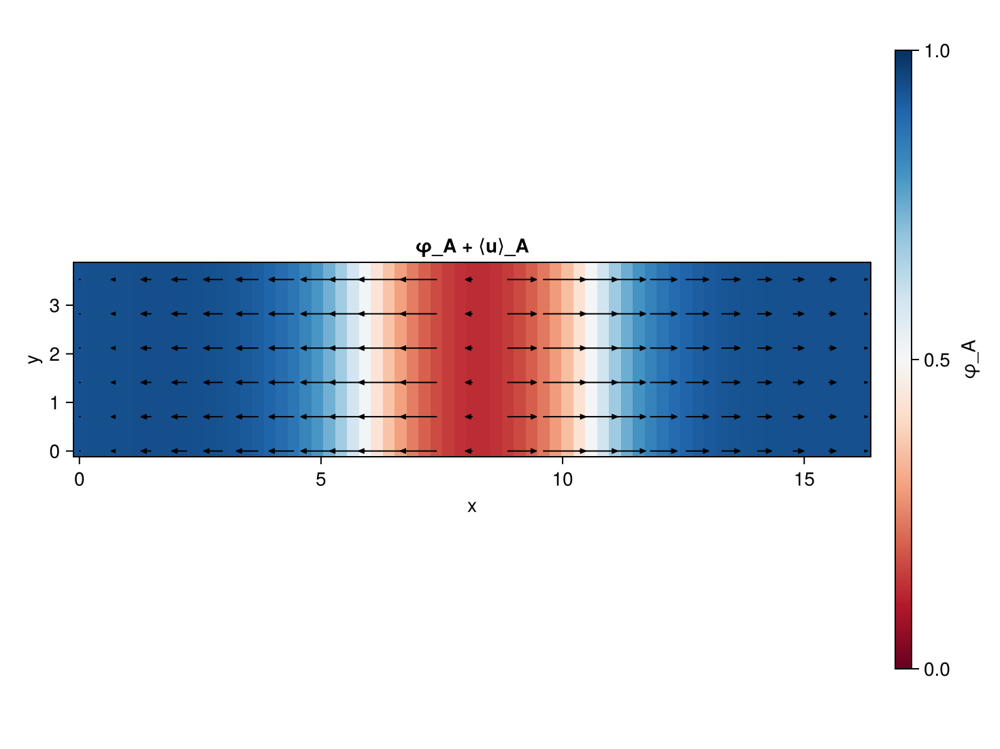
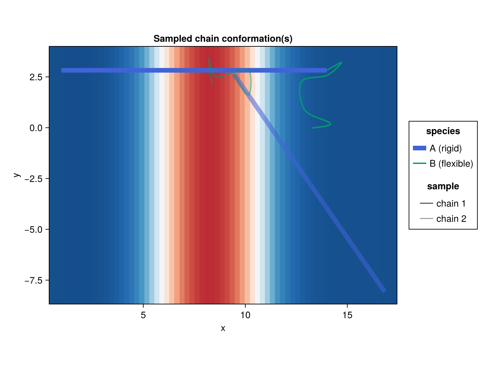

# Worm-Like Chains & Orientational Order

The [Self-Consistent Field Theory tutorial](../tutorials/scft.md) builds an `SCFTSystem`
from Gaussian chains, whose `DiscreteGaussianChainPropagator` has no notion of bond
orientation at all — only position. Giving species a [`WormLikeChain`](@ref
ClassicalDFT.WormLikeChain) or [`RigidRod`](@ref ClassicalDFT.RigidRod) representation
(see [Chain representations](@ref)) instead tracks their full 3D bond orientation
alongside position, via `WLCPropagator`. This tutorial builds a rod-coil diblock melt
(one exactly rigid species, one semiflexible) and shows the three things that unlocks
beyond a density profile: a nematic order parameter, a mean orientation vector field, and
actual sampled single-chain conformations.

## Building the worm-like-chain model

Each species gets its own chain representation: `"A"` (the rod) is an exactly rigid
[`RigidRod`](@ref ClassicalDFT.RigidRod), `"B"` (the coil) a semiflexible
[`WormLikeChain`](@ref ClassicalDFT.WormLikeChain) with bond length `b` and persistence
length `lp`:

```julia
julia> using ClassicalDFT

julia> N_A, N_B = 14, 6

julia> f = N_A / (N_A + N_B)   # 0.7 -- rod is the majority species

julia> model = SCFTModel([("diblock", ["A"=>N_A, "B"=>N_B])];
                         rho0 = 1.0, L_max = 6,
                         chain = Dict("A" => RigidRod(b=1.0),
                                      "B" => WormLikeChain(b=sqrt(2), lp=0.5*sqrt(2))),
                         interactions = (FloryHugginsChi(Dict(("A","B") => 0.8)),
                                         HelfandCompressibility(25.0)))
```

(The legacy form `SCFTWormLikeChainFluid(grouplist, b, lp, chi; rho0, kappa, L_max)`
builds the same model.) `L_max` is the spherical-harmonic truncation degree used to
resolve each bond's orientation distribution — larger for stiffer species and more
strongly aligned states, at the cost of more orientation-grid nodes per SCFT iteration.

As in every other tutorial, chain connectivity is supplied separately via
`mol_structure`:

```julia
julia> mol_structure = Dict("diblock" => custom_structure("A"^N_A * "B"^N_B))
```

## Seeding and converging

This example uses a 2D structure (`LamellarStack2DCart`) rather than 1D, purely so the
chain-conformation plots later in this tutorial have a second axis to show orientation
in — the physics itself is uniform along `y`. `core_fraction=f` seeds the core (rod)
layer at its own composition fraction rather than assuming an even 50/50 split, which
matters here since the two species have very different lengths:

```julia
julia> Lx, Ly = 16.5, 4.0   # Lx: the equilibrium period for this system, found separately
                            # by minimizing free energy over a range of L -- not repeated here

julia> ngrid = (67, 17)

julia> structure = LamellarStack2DCart((0.0, 0.0), [1.0], [0.0 Lx; 0.0 Ly], ngrid;
                                        core_groups=["A"], core_fraction=f)

julia> n_chains = (Lx * Ly) / (N_A + N_B)

julia> system = SCFTSystem(model, structure, DFTOptions();
                            mol_structure=mol_structure,
                            ensemble=[:canonical],
                            n_molecules=[n_chains])
```

An exactly rigid species pushes the Anderson-accelerated solver's default step size past
its stability limit for this system — pass a smaller `beta` explicitly:

```julia
julia> ρ = initialize_profiles(system)

julia> result = converge!(system, ρ; tol=1e-5, maxit=3000, beta=5e-3, verbose=true)
```

```
SCFT converged after 920 iterations: err = 6.27e-5 | F = 10.2428
```

```julia
julia> plot(system, ρ)
```



## Orientation order and the mean orientation field

Position isn't the only thing resolved in space anymore. `orientation_order_parameter`
gives the local nematic order `S_α(x) = (3⟨u_x²⟩_α(x)-1)/2` (`S=1`: fully aligned with
the domain normal; `S=-1/2`: fully perpendicular) — but computing it needs `q_in`/`q_out`
resolved in orientation, one more `propagate!` call at the converged field (the same
extra step `compute_densities!` takes internally to build `ρ` from a marginalized
version of the same quantity). Every WLC function below takes `ρ` and computes
`q_in`/`q_out` internally, so none of that is visible here:

```julia
julia> S = orientation_order_parameter(system, ρ; axis=1);
```

`S` is nonzero even for a perfectly head-tail-symmetric alignment (`u` and `-u` equally
likely) — it only measures *nematic* order. `mean_orientation_field` instead gives the
true polar vector `⟨u⟩(r)`, which is only nonzero when there's a genuine directional
bias — here, because each rod is covalently bonded to a coil at one specific end:

```julia
julia> mean_u = mean_orientation_field(system, ρ);

julia> plot_orientation_field(system, ρ; species=1)
```



The arrows flip direction right at the coil domain's own center and again at the
periodic boundary — a real, reproducible sign structure, not noise (see the
[`mean_orientation_field`](../api/methods.md#Orientation-(WLC-only)) docstring for why
this can be a much smaller vector than the nematic order `S` alone would suggest, and
[Chain Conformation Sampling](../api/methods.md#Chain-Conformation-Sampling-(WLC-only))
for what's driving it).

`plot_orientation_field` needs a Makie backend loaded (e.g. `using CairoMakie`) — it's a
stub in the main package otherwise, following the same pattern as `Makie.plot(system,
ρ)` itself. Each of the three calls above reruns `propagate!` on its own — fine here,
but wasteful when calling several of these functions back to back; see the note at the
end of this section for how to avoid that.

## Sampling single-chain conformations

Every quantity above — `ρ`, `S`, `⟨u⟩` — is an ensemble-averaged marginal.
`terminal_orientation_anchor` finds a terminal bead's own most-likely position (and
either its most-likely or mean orientation there), and `sample_chain` reconstructs one
full, concrete bead-by-bead realization consistent with the converged field, walking
away from that anchor:

```julia
julia> using Random

julia> r0, u0, mean_u_1 = terminal_orientation_anchor(system, ρ, 1; orientation=:mean);

julia> R1 = sample_chain(system, ρ, 1, r0, u0; rng=MersenneTwister(1));

julia> r0N, u0N, mean_u_N = terminal_orientation_anchor(system, ρ, N_A + N_B; orientation=:mean);

julia> R2 = sample_chain(system, ρ, N_A + N_B, r0N, u0N; rng=MersenneTwister(2));

julia> plot_chain_conformations(system, ρ, [R1, R2])
```



Bead `1` is the rod's free end, bead `N_A+N_B` the coil's — each anchored independently
at its own most-likely position. Every rod-rod bond is exactly rigid (`lp=Inf`), so the
rod segment of each sampled chain is a perfectly straight line, drawn thick; only the
flexible coil bonds (and the rod-coil junction) are genuinely random per call, drawn as
a thin curve through the sampled bead positions. `chain 2` (the coil-anchored draw) is
faded relative to `chain 1` so the two stay distinguishable without needing a separate
color per chain — species identity (rod vs. coil) is what the color encodes instead.
Since a sampled conformation can legitimately wander outside the structure's own
periodic box (unlike a density profile, which never needs to), `plot_chain_conformations`
tiles the background to whatever extent the chains actually reach and crops the axes to
that same extent, rather than showing the full periodic structure around them.

`plot_chain_conformations(system, ρ, [1, N_A + N_B]; orientation=:mean,
rng=MersenneTwister(1))` anchors and samples both chains internally and produces the
same figure in one call, without naming `r0`/`u0`/`mean_u_1` individually.

Every call above (`orientation_order_parameter`, `mean_orientation_field`,
`terminal_orientation_anchor` ×2, `sample_chain` ×2) reran `propagate!` from scratch —
six times, for the one converged `ρ`. Pass `q_in`/`q_out` explicitly, computed once via
`compute_propagator_fields`, to skip all but the first:

```julia
julia> q_in, q_out = compute_propagator_fields(system, ρ);

julia> S = orientation_order_parameter(system, ρ; axis=1, q_in=q_in, q_out=q_out);

julia> r0, u0, _ = terminal_orientation_anchor(system, ρ, 1; orientation=:mean, q_in=q_in, q_out=q_out);

julia> R1 = sample_chain(system, ρ, 1, r0, u0; rng=MersenneTwister(1), q_in=q_in, q_out=q_out);
```

Every function in this tutorial takes `q_in`/`q_out` this same way: omit them and they're
computed from `ρ`; pass them (e.g. from a previous call, or from `compute_propagator_fields`
directly) and they're used as-is, with no recomputation.

## Next steps

- [`MaierSaupe`](@ref ClassicalDFT.MaierSaupe) adds an explicit orientational coupling
  between species, on top of the immiscibility-driven alignment shown here. Start
  `converge!` with `director=(0, 0, 1)` to let a nematic state develop, and see
  [Bulk thermodynamics](@ref) for nematic bulk phases and isotropic–nematic coexistence.
  With Maier-Saupe or [`Incompressible`](@ref ClassicalDFT.Incompressible), the converged
  propagators depend on solver state that `ρ` alone doesn't determine, so the functions
  above need it passed in: `q_in, q_out = compute_propagator_fields(system, ρ, result)`
  with `result = converge!(system, ρ; ...)`.
- `orientation_order_parameter`/`mean_orientation_field`/`sample_chain` all work
  identically for `dimension(system) ∈ {1,2,3}` (only `plot_chain_conformations` itself
  is currently 2D-only) — see [Methods](../api/methods.md) for the full list.
- [Block-Copolymer Microphase Morphologies](@ref) covers every other `LamellarStack*`/
  `HexLattice*`/`BCC3DCart`/`Gyroid3DCart` seed, all of which work as `SCFTSystem`
  structures the same way.
